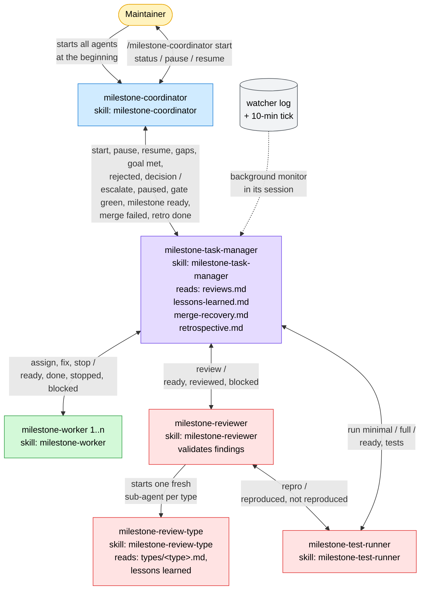

# Agents and skills (draft)

Which AI agents take part in the [multi-agent milestone workflow](multi-agent-workflow.md), their skills, and how
the skills become active. The installable files are in [skills/](skills/README.md) and [agents/](agents/).

## Principle: one skill per agent

- **Agent definition** (`agents/<agent>.md`, installed to `.claude/agents/`): who the agent is, its tools, and its
  preloaded skill.
- **Skill** (`skills/<agent>/SKILL.md`, installed to `.claude/skills/`): everything the agent does, in one file.
  Details it needs only now and then are reference files next to it (read on demand), e.g. the 11 review
  checklists.
- **Hooks** enforce the hard rules (never merge into `main`, reviewers without git, `--ignore-scripts`, message
  limits, no file writes by agents without Edit/Write - also not through Bash). Skills are guidance; a rule that
  must never be broken belongs in a hook as well.
- **State lives in files, not in the conversation.** Messages are only triggers; whatever an agent needs to resume
  after a crash or context compaction is in the task notes or the review folder.

## State and who writes it

Every file has exactly one writer at a time; readers never write. `<common>` is
`$(git rev-parse --git-common-dir)` (shared by all worktrees, not versioned).

| State | Where | Writer | Readers |
|---|---|---|---|
| Milestone and planned tasks | task files, created in the maintainer's checkout before `start M<n>` | coordinator (`$BNG cli`, planning only) | all |
| A running task's file (status, notes, AC) | the task's worktree, committed on the task branch by the watcher | its worker from `assign`/`fix` until `done`/`stopped`/`blocked`; then the task manager until the next `fix` or the merge | all |
| New tasks (fix, gap, regression, compensation, sync) and drafts | task manager's milestone checkout | task manager | all |
| Code of a task | task branch and worktree `task-<id>-<slug>` | its worker | reviewer (`tree`), test runner (own worktree) |
| Milestone branch `milestone-<slug>` | task manager's milestone checkout `<repo>.worktrees/milestone-<slug>` | task manager (merges, lessons commits) `OPEN(#3)` | all |
| Lessons-learned file | milestone checkout, committed on the milestone branch | task manager | workers (`git show milestone-<slug>:<path>`), review-type sub-agents |
| Diff files, findings files | `<common>/backlog-ng/reviews/` | diff: task manager; findings: reviewer | task manager, workers (via task notes) |
| Test logs and reports | `<common>/backlog-ng/tests/` | test runner | task manager, reviewer |
| Milestone review report | milestone review task's branch and worktree | task manager | maintainer (review app), coordinator |
| Retrospective `docs/retros/m<n>.md` | improvement task's branch | task manager | coordinator, maintainer |
| `main` | maintainer's checkout | the watcher only, after the maintainer's approval | all |

Branches: `main` ← milestone review task branch ← (`$BNG update`) milestone branch ← task branches. The milestone
branch is the only integration branch: every code change, also after the hand-off (rejections, compensation), goes
through a task branch into it; the milestone review branch gets only the report commits and merges of the
milestone branch.

## Who starts whom

- **The maintainer starts all long-running agents at the beginning of the run**: coordinator, task manager,
  workers (1..n), reviewer, test runner. No agent starts another long-running agent. `OPEN(#4)`: as teammates of
  one team (the coordinator as lead) or as separate sessions with another message channel.
- **The reviewer starts the only sub-agents**: one fresh `milestone-review-type` sub-agent per review type and
  review, so no review is done by an agent that saw the code before. `OPEN(#4)`: whether a teammate can start
  sub-agents.
- Each agent except the coordinator reports `ready <role>` to the task manager once; the task manager does not
  start a milestone without the reviewer, the test runner and at least one worker.

## The agents and their skills

| Agent | Runs as | Started by | Tools | Skill (preloaded) | Reference files (on demand) |
|---|---|---|---|---|---|
| **milestone-coordinator** | main session (lead) | maintainer: `claude --agent milestone-coordinator` (to verify) or `/milestone-coordinator start` | Read, Grep, Glob, Bash (`$BNG cli` for planning, read-only git), SendMessage | planning, supervision, loop guard, goal check, hand-off | – |
| **milestone-task-manager** | long-running, own milestone checkout | maintainer, at the beginning | + Edit, Write (diff files, reports, lessons-learned file, retrospective only) | dispatch, Pareto rule, merge queue, milestone gate, messages | `reviews.md` (scope, review types, Pareto), `lessons-learned.md` (when and how to record a lesson), `merge-recovery.md`, `retrospective.md` |
| **milestone-worker** (1..n) | long-running, own worktree per task | maintainer, at the beginning | all | implement, test, commit, fix findings, report | the project's lessons-learned file |
| **milestone-reviewer** | long-running | maintainer, at the beginning | Read, Grep, Glob, Agent, SendMessage, Write (findings files only) | starts the review-type sub-agents, validates findings (double-check, duplicates, severity), findings file | `types/01-logic.md` … `types/11-test.md` (passed to the sub-agents) |
| **milestone-review-type** | sub-agent, fresh per type and review | reviewer | Read, Grep, Glob only | scope (diff only), severity, finding format, lessons check | its type's checklist, the lessons-learned file |
| **milestone-test-runner** | long-running, own detached worktree per request | maintainer, at the beginning | Read, Grep, Glob, Bash, Write (test folder only), SendMessage | minimal/full suite, flaky check, bisect, reproduction of findings, report format | – |

## How a skill becomes active

- **Preloaded**: each agent definition lists its skill under `skills:`, so the full skill text is in the agent's
  context from its first turn. This is the normal way.
- **User command**: the coordinator's skill is also a slash command (`/milestone-coordinator start|status|pause|resume`),
  so the maintainer can start a milestone from any session. All other skills have `user-invocable: false` and stay
  out of the maintainer's `/` menu.
- **Reference files** are not skills: the skill text says when to read which file (e.g. the task manager reads
  `merge-recovery.md` when the watcher logs a failed merge; the reviewer passes each sub-agent only its own type's
  checklist).

Note: a skill with `disable-model-invocation: true` cannot be preloaded, so none of these skills uses it. Each
description names its agent, so other agents don't pick a skill up by accident.

## Messages between agents

Short, typed, one task or review per message, no acknowledgements; the details are in the task files and the
review folder. Every message must lead to a state change (loop guard).

| From → to | Message | Meaning |
|---|---|---|
| worker, reviewer, test runner → task manager | `ready <role>` | started by the maintainer, waiting for work |
| coordinator → task manager | `start M<n>` | milestone planned and approved, tasks created |
| task manager → worker | `assign TASK-<id>` / `fix TASK-<id>` / `stop TASK-<id>` | start / fix findings from the notes / commit and hand back |
| worker → task manager | `done TASK-<id> <commit>` | implemented or fixed, minimal suite green, committed |
| worker → task manager | `stopped TASK-<id> <commit>` | after `stop`: state in the notes, not reviewed; the task goes back to dispatch |
| worker → task manager | `blocked TASK-<id>: <one line>` | unclear scope, missing dependency, disputed finding |
| task manager → reviewer | `review TASK-<id>\|M<n> r<n> diff=<path> tree=<path> commit=<sha> lessons=<path> [types=<list>]` | review this diff (milestone review: all types) |
| reviewer → task manager | `reviewed <review>: <c> confirmed, <d> dropped <file>` | validated findings are in the findings file |
| reviewer → task manager | `blocked <review>: <one line>` | e.g. cannot start sub-agents |
| reviewer → test runner | `repro <review> f<k> commit=<sha>: <test or command>` | try to reproduce a critical/major finding |
| test runner → reviewer | `repro <review> f<k>: reproduced \| not reproduced <log>` | result of the reproduction |
| task manager → test runner | `run minimal\|full <branch> <commit>` | run a suite (full: with bisect on failure) |
| test runner → task manager | `tests <suite> <branch> <commit>: green\|red\|error <report>` | result and report file (`error`: the suite could not run) |
| task manager → coordinator | `escalate TASK-<id>\|M<n>: <question>` | a maintainer decision (incl. fix or defer a critical/major finding), a missing agent, or the loop limit |
| task manager → coordinator | `paused` | after `pause`: no task runs any more |
| task manager → coordinator | `gate green` | full suite and milestone review done; goal check next |
| coordinator → task manager | `goal met` / `gaps <list>` | result of the goal check |
| task manager → coordinator | `milestone ready <commit>` | report committed, milestone review task In Review |
| coordinator → task manager | `pause` / `resume` / `rejected <list>` / `decision TASK-<id>: <answer>` | from the maintainer |
| task manager → coordinator | `merge failed <cause>: <compensation>` | the watcher could not merge the approved milestone |
| task manager → coordinator | `retro done <file>` | retrospective written, improvement task created or none needed |
| monitor → task manager | watcher log line, 10-min tick | wake-up for events no agent sends: a background monitor in the task manager's own session `OPEN(#38)` |
| hook → agent | `blocked: escalate to the coordinator` | message limit reached for this task and pair |

## Open points

See [open-points.md](open-points.md); the skills mark every provisional rule with `OPEN(#n)`.
