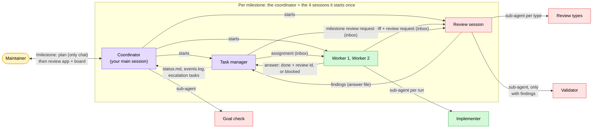
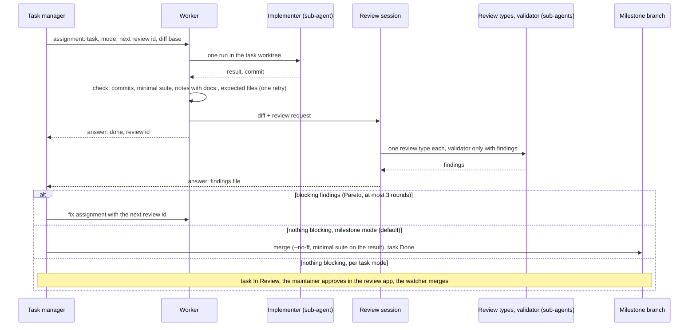
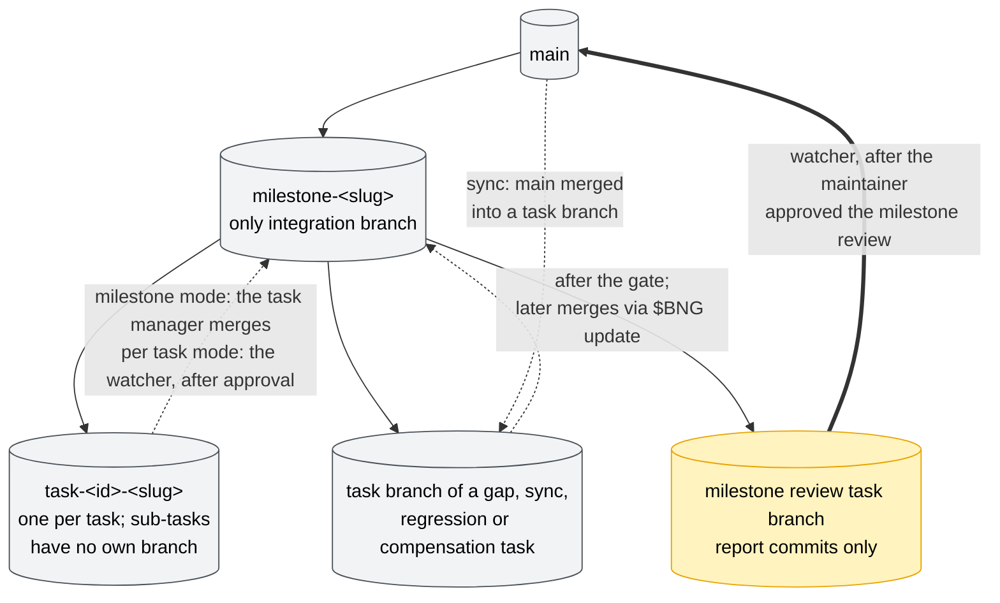

# Multi-agent milestone workflow: v1 blueprint (draft for the team)

Status: **draft for discussion**. It isn't in force until the maintainer accepts it. It summarises the v1 decisions
of four review sessions (architect, requirements engineer, docs reviewer, critical reviewer). The other files in this
folder describe the earlier, larger design and stay frozen until the spike and the dry run (section 11).
Reading time: about 10 minutes.

## 1. Problem and goals

**Problem.** In a feature-branch workflow with manual review, every task waits for the maintainer. With AI agents
writing most of the code, the maintainer's review becomes the bottleneck. The maintainer still has to stay in
control of what reaches `main`.

**Idea.** Move the review work to agents, so the maintainer reviews only what has already passed. Agents implement
and review the **tasks** of a milestone; every task gets an agent review of the whole task before it is merged into
a milestone branch. The **whole milestone** gets a full test run, a cross-cutting review and the maintainer's manual
review before it is merged into `main`. **Review mode**, asked once at planning: by default (`milestone`) the
maintainer reviews only the milestone; with `per task` (opt-in, only if the maintainer asks for it) they also approve
each task in the review app after its agent review.

Work is planned in **milestones, tasks and sub-tasks**, with **no extra manual review per sub-task**. Sub-tasks
are steps of one task with no own branch. After its last sub-task, the whole task always gets one full agent review; a bigger task
(> ~400 lines) also gets an agent review per sub-task on its own commits. In `per task` mode the whole task then gets
one manual review; agent reviews always finish first (open point #42). Work bigger than one reviewable branch is still split into several tasks with
dependencies.

**Why v1 is small.** The first blueprint used six long-running agents that talked to each other by messages. Most of
its complexity came from that one choice, not from the problem itself: about 25 message types, handshakes, a loop
guard with its own hook, stall and crash protocols, and one-writer hand-overs. v1 drops it. A coordinator (the maintainer's
session) and one task manager per milestone start short-lived sessions, and every session returns its result as a
file. The aim is the smallest
flow that runs a milestone end to end and can be measured against a simple baseline.

### Goals

| # | Goal | How it is checked |
|---|---|---|
| **G0** | **Worth it**: less maintainer time and no more escaped defects than the baseline, at least as fast | Dry run, see below |
| G1 | Low maintainer effort: after planning, the maintainer only acts in backlog-ng (review app, escalation tasks on the board), never in chat (section 10, #24) | By default one milestone review plus escalation tasks; every maintainer interaction maps to a decision; no session waits on the maintainer in chat |
| G2 | Nothing unchecked reaches `main` | The report has evidence for every gate; only the watcher merges into `main`, and only after approval |
| G3 | Traceability: goal → criterion → task → commits → reviews → findings and their fate | The task notes and the report name them for every change |
| G4 | Recoverability: a crash loses no work | The coordinator and the task manager resume from files and git (`/milestone resume`) |
| G5 | Bounded cost: no endless rounds or retries | 60 min per assignment (a guess), one retry, 3 review rounds, one fix round at the gate |
| G6 | Each milestone runs a bit smoother than the last, without the process growing | Manual retro (section 8) |

**G0, how it is measured.** The same demo milestone, with the same seeded defects, runs twice: once with v1 and once
with the **baseline**. The baseline is one Claude session per task plus `/code-review` plus the maintainer's review,
with the same parallelism (2 sessions at a time).

- *Maintainer time*: logged minutes per interaction. By default (review mode `milestone`) the maintainer reviews
  only the milestone review task, plus the escalation tasks; with review mode `per task` (opt-in at planning), also
  every task, including fix, sync, regression and gap tasks. The G0 dry run uses the default mode.
- *Escaped defects*: seeded defects not caught before the manual review, plus defects the maintainer finds.
- *Pass*: at least 30 % less maintainer time, no more escaped defects, and wall-clock time no slower than the
  baseline. The measured speed-up is reported; the maintainer sets a speed target after the dry run. Tokens are
  reported but don't decide. A tie means no go.
- The 30 % is the maintainer's starting value, not derived from data (n = 1).
- Fairness: a script or another session places the seeded defects and lists them in a sealed file. The maintainer
  opens it only after both runs. v1 runs first and the baseline second, so the maintainer's growing familiarity with
  the demo favours the baseline, not v1.
- The cost of parallelism stays visible: two tasks have a planned file overlap, and time for merge conflicts and
  re-reviews is logged separately.

## 2. The v1 design in one picture



- **Five sessions; sessions supervise, sub-agents work.** The coordinator is the maintainer's main session and the
  only one the maintainer talks to. It starts four sessions once per milestone (in the Claude desktop app): the task
  manager, two workers and a review session. The task manager owns everything in backlog-ng, assigns tasks to the
  workers, collects the review results and plans the follow-ups; it runs no sub-agents. A worker has each task run
  done by a fresh implementer sub-agent, checks it and hands it straight to the review session. The review session
  runs one fresh sub-agent per review type, and a validator only when there are findings, and answers the task
  manager. The goal check is a sub-agent of the coordinator (revised D1 and D13, maintainer's decisions).
- **No messages between agents.** A sub-agent gets its input as a prompt and files and answers in its response;
  sessions exchange only files (inboxes for assignments and review requests, answer files for results).
  State lives in task files, git and the review and test folders, never in a conversation.
- **Fresh context per step.** An implementer sub-agent that never saw the previous task can't drift. A reviewer that never saw the
  code isn't anchored on it. A validator that didn't write the findings judges them independently.
- **Nobody just watches.** After every wake-up both sessions run an idle check: they take the next step from the
  state files and git (dispatch, review, merge, goal check, hand-off, retro). If only the maintainer can move, it is
  signalled; if nothing can move, the maintainer gets ⚠️ "stuck" with the state and an escalation task.
- **Recovery is one path.** An implementer whose result fails the worker's check is retried once (`mode: resume`). A
  session with no answer 60 min after an assignment, or that ended its turn mid-milestone, is replaced once and the
  work is given again; failing again, it is escalated. If the
  task manager dies, `/milestone resume` in the coordinator restarts it, and it rebuilds its state from the files.

## 3. Roles

| Role | Kind | Does | Never |
|---|---|---|---|
| Maintainer | human | sets the goal, approves the plan, answers escalations, does the manual review, approves skill changes | – |
| Coordinator | the maintainer's main session | plans with the maintainer, starts the task manager, answers its escalations with the maintainer, starts the goal check, does the hand-off (report, milestone review task), drafts the retro | implements, reviews code, merges, approves tasks, changes task statuses during the run |
| Task manager | one session per milestone | owns backlog-ng during the run: assigns tasks to the workers, collects the review results, applies the Pareto rule, after a passed agent review merges the task (`milestone` mode, interim) or sets it In Review (`per task` mode), reacts to rejections and the watcher, runs the gate | talks to the maintainer, implements, reviews code, merges anything else, approves tasks, defers critical/major findings |
| Worker | 2 sessions per milestone, started once | takes one task assignment at a time, has an implementer do it, checks the result (commits, minimal suite green, notes with `docs:`, expected files), hands it to the review session | implements by itself, merges, decides about findings |
| Implementer | fresh sub-agent of a worker, per task run | implements, fixes or merges in one task in its own task worktree, writes tests, runs the minimal suite, commits, writes task notes | merges, touches other worktrees, fixes things outside the task |
| Review session | 1 session per milestone, started once | per hand-over or milestone review request: selects the review types, runs the review-type and validator sub-agents and the reproductions, writes the validated findings | reviews or validates by itself, decides about findings |
| Review type | fresh sub-agent of the review session, per type | reports findings of one type on one diff | anything else (read-only tools) |
| Validator | fresh sub-agent of the review session, per review with findings | confirms or drops findings (format, scope, duplicates, re-read of critical/major in context) | reviews by itself, edits files |
| Goal check | fresh sub-agent of the coordinator, per gate run | compares the result with the maintainer's goal, criterion by criterion | edits files (read-only tools) |
| Test script | script | minimal/full suite, one rerun of a failed test (flaky check), `git bisect run`, report file | – |
| backlog-ng | tool | task board (Backlog.md files), branches, worktrees; its **review app** is where the maintainer approves each task and the milestone; its **watcher** merges approved tasks into the milestone branch and the approved milestone into `main` | – |
| Hooks | Claude Code hooks | block hard-rule violations for every agent (section 7) | – |

## 4. Milestone flow

One task, from assignment to merge (fix rounds go back to the worker; the gate, goal check and hand-off follow in
the table):



| Step | Who | What happens | Exit |
|---|---|---|---|
| 0. Start | maintainer → coordinator | `/milestone start` runs a check script first: `CLAUDE.md` names `$BNG`, the two test commands, the docs and the lessons file; hooks are installed; the watcher runs; no other milestone is open; the skills and agent files are installed in `.claude/` (same version as the blueprint); the milestone checkout, if any, is clean after `git worktree prune`. Uncommitted changes in the main checkout only give a warning (they would make the watcher's merge fail). The script lists what's missing and stops. `/milestone resume` continues an open milestone from the files and git. Every task still In Progress has lost its implementer, so a fresh implementer continues it in its existing worktree from the task notes and the uncommitted state, without running `$BNG start` again. | checks pass |
| 1. Plan | coordinator with the maintainer | The goal is stored **verbatim**, with success criteria (each with "verified by") and an out-of-scope list. The goal is split into tasks that meet the Definition of Ready (below), and the maintainer approves the plan. The coordinator asks once: "Do you want to review every task yourself in this milestone? Default: no", and writes `review mode: milestone \| per task` into the milestone review task. In `milestone` mode the milestone stays ≤ ~2,000 changed lines (a guess to calibrate in the dry run); bigger goals become several milestones. Then the coordinator creates the milestone, the tasks and the milestone review task, and starts the task manager. | plan approved |
| 2. Dispatch | task manager | Takes the next ready task (dependencies merged). Tasks whose expected files overlap a running task wait. Before each assignment to a worker, the task manager itself creates the milestone branch (first time) and runs `$BNG start`, so there are no races. At most 2 implementers run at a time. | implementer running |
| 3. Implement | worker (implementer sub-agent) | Tests for each acceptance criterion, code, minimal suite green, focused commits, task notes. Unclear scope → the implementer returns "blocked" instead of guessing. | implementer returns done |
| 4. Task review | review session (review-type and validator sub-agents) | Diff of the task only; the types that fit the diff; the validator confirms findings (section 6). | confirmed findings |
| 5. Pareto | task manager | Blocking findings → a fresh fix implementer in the same worktree, reading the notes and findings. Minor findings → the milestone report's "Deferred minor findings" list. Limits in section 6. Nothing blocking → the task manager ticks the DoD. `milestone` mode: next step 6. `per task` mode: it sets the task **In Review**; only now does the review app offer it to the maintainer. | agent review passed |
| 6. Merge (and task approval) | task manager or maintainer + watcher | `milestone` mode: the task manager merges the task into the milestone branch (interim, until backlog-ng's agent finish; section 5) and sets it Done. `per task` mode: the maintainer reviews the task in the review app and approves it (Done) or rejects it with a note; the watcher merges an approved task after its quality gate (`tools/verify.sh`); rejected → fix implementer, agent re-review of the fix commits (not a Pareto round), In Review again. | merged into the milestone branch |
| 7. Gate | task manager, test script, review session | Once all tasks are merged: (a) sync with `main` if it moved (a sync task); (b) full suite, failures bisected to a task merge → regression tasks; (c) milestone review on the milestone diff. One fix round per gate run. | green (flaky tests listed); no critical/major left unless the maintainer deferred it. Findings or failing tests left after the fix round → escalate "fix or defer". |
| 8. Goal check | goal-check session (started by the coordinator) | Evidence per criterion, or "not met", or "for the manual review". Gaps → gap tasks, then the gate again. | goal met |
| 9. Hand-off | coordinator | Checks the review app, writes the report text first, then back to back starts the milestone review task (its branch starts from the milestone branch; the review app may offer it as soon as its worktree exists), commits the report on it (goal check, tests, reviews and the fate of each finding, the deferred minor findings list, deferred critical/major items, lessons) and sets the task In Review. Tells the maintainer in at most 10 lines (a guess to calibrate). This step runs once per milestone; later hand-offs follow step 10. | In Review |
| 10. Milestone review | maintainer | Approve the milestone review task, or reject it with a list. Rejected points → fix tasks, then gate 7 and goal check 8 on the new commits only. The hand-off then runs `$BNG update` in the existing review worktree, commits a report addendum (what was rejected, what changed) and sets the task In Review again. No new review task. | approved |
| 11. Merge into `main` | backlog-ng watcher | Merges the milestone review branch. A failure is noticed by a Monitor on the watcher log, or on the next `/milestone resume`, and is handled per section 5. | `main` updated |
| 12. Retro | coordinator, maintainer | Manual retro note (section 8). | milestone closed |

**Task sizing** (planning): plan the fewest tasks that keep each ≤ ~400 changed lines including tests (rough count:
estimated lines / 300). A task under ~150 lines is merged into a neighbour unless it is risky on its own (security,
user data, migration). A task may serve several success criteria: cut by code area and size, not one task per
criterion.
**Definition of Ready** (task): it serves at least one success criterion; what and why in ≤ 5 lines, ≤ 5 testable
acceptance criteria, expected files and dependencies listed; within the sizing above (a guess to calibrate); no open
question. Task notes stay ≤ ~10 lines (what changed, the test per AC, not tested, decisions). Sub-tasks (one level, optional) are steps of a task: no own branch
and no manual review of their own. Each sub-task has what, the parent AC it covers, its expected files and its order,
is ≤ ~400 changed lines; sub-tasks run one after another. Every parent gets one full agent review after its last
sub-task; a bigger parent (> ~400, ≤ ~1,000 lines; a guess to calibrate in the dry run) also gets an agent review per
sub-task before the next one starts. Bigger work is still several tasks with dependencies, each leaving the milestone branch
green (e.g. add the new interface → migrate the callers → remove the old one).
**Definition of Done**: acceptance criteria ticked and tested; **the product docs of what the task changed are
updated** (README usage or reference for user-visible behaviour; decision records and `CHANGELOG.md` only if the
project keeps them); minimal suite green on the task branch and on the merged result; no blocking finding; task notes
complete, with a `docs:` line (files, or `none needed (<why>)`); merged with `--no-ff`. Doc lines don't count toward
the task size.

**Escalation** is a task on the board: the task manager or the coordinator creates it in the milestone with the
label `escalation` (context, options, what waits on it). The maintainer answers in its notes and sets it Done; only
the work that depends on it waits. **After planning, the maintainer is out of the chat loop**: nobody asks in chat
or waits for a chat answer. The coordinator and the task manager wait for their sessions and for backlog-ng, not for
the maintainer (open point #24). **Signals:** the coordinator's session title shows what waits for the maintainer
(`👀 <n>` reviews in the review app, `⚠️ <m>` open escalations, stuck sessions or failed steps, `✅` merged), and
each new item also gets a chat line, an unread mark and a notification. On every wake-up the coordinator checks its
linked sessions and reports one that waits on a prompt, stays silent past its limit or ended without an answer; it
never answers another session's prompt itself.

## 5. Branches and merge rules



- `milestone-<slug>` is the **only integration branch**. Every code change reaches it through a task branch: normal
  tasks, fix, gap, sync and regression tasks, and compensation after a failed merge into `main`.
- **Agent review comes first, in both modes.** Every task is merged only after its validated agent review found
  nothing blocking.
- **`milestone` mode (default): the task manager merges (interim).** Until backlog-ng can finish a task review as
  agent (open point #3), the task manager merges the task branch into the milestone branch in its own milestone
  checkout (`--no-ff --no-commit`, minimal suite on the result, then the commit) and sets the task Done. A hook allows
  exactly this merge and nothing else on `milestone-*`. Tasks never go In Review, so the review app never offers
  them; the milestone review shows their commits as open, and the maintainer reviews them there, grouped by task.
- **`per task` mode: the watcher merges after the maintainer's approval.** A task goes In Review only after its agent
  review; the review app offers a task only while it is In Review. After approval (Done) the watcher merges it once
  `tools/verify.sh` is green; the task manager's milestone checkout is detached and read-only.
- **Status only at start and merge.** A task goes In Progress once and Done once (plus In Review in `per task`
  mode); fix rounds, merge-ins and aborted merges change only its notes.
- **Rejected or not merged.** A rejection in the app (`per task`) sends the task back to In Progress; a merge aborted
  by a conflict or a red gate only adds a note. A fresh implementer fixes it, or merges the milestone branch into the task branch. The agent
  re-review of the new commits doesn't count as a Pareto round. Then In Review again (`per task`) or merged again (`milestone`).
- **Nothing merged is rewritten.** No rebase, no reset, no force push. Agents never merge into `main` or push.
- **One writer per file.** While a implementer runs, only it writes its task file and worktree. The task manager writes a
  task's file only after that implementer has returned. Done is set by the review app (`per task`) or by the task manager after its own merge (`milestone`); only the review
  app ticks the approval.
- The milestone review task's branch gets only the report commits and, through `$BNG update`, later merges of the
  milestone branch. The watcher merges it into `main` after the maintainer's approval.
- **#3, by mode.** In `per task` mode every task commit has an approved task review, so the milestone review doesn't
  show them as open. In `milestone` mode the hand-merged commits show as open, which is intended: that is where the
  maintainer reviews them.

**Merge into `main` fails** (the watcher logs `auto-merge aborted`):

| Cause | What the task manager does | Maintainer reviews again |
|---|---|---|
| Conflict with `main` | Compensation task: merge `main` into a task branch, resolve, review the resolution only, merge, full suite; then `$BNG update` and an addendum, as after a rejection | only the new commits |
| Quality gate red on the merged result | Regression task: fix on a task branch, merge, full suite; then `$BNG update` and an addendum, as after a rejection | only the fix commits |
| Technical (git busy, watcher down) | No code change; wait for the watcher's retry (up to 15 min, a guess to calibrate), then escalate | no |
| Unknown, or failed twice | Escalate with the log lines and what was tried | the maintainer decides |

## 6. Reviews and tests

**Scope: the diff only.** A task review sees `git diff $(git merge-base milestone-<slug> <task>)..<task>`. A
re-review sees only the fix commits. The milestone review sees the milestone diff against `main`. Reviewers may read
unchanged code for context, but a finding must be about a changed line, or about old code that the change makes
reachable or worse.

| Review | Sub-agents (fresh, one each) |
|---|---|
| Task review, diff ≤ ~150 lines | **one** sub-agent with the merged logic + code + test + security checklist |
| Task review, larger diff | **logic + code + test** (one merged checklist), **security**, and only if their trigger files changed: architecture, data safety, cross-platform, dependencies, usability |
| Milestone review | **one** sub-agent: logic across tasks + architecture + docs |

**Product docs** are checked in every review: the logic checklist treats a user-visible change without its doc as
major, and the milestone sub-agent runs the docs checklist on what the whole milestone changed.

The **validator** runs only if there is at least one raw finding; with none, the review session writes the findings
file itself (`0 confirmed, 0 dropped`). The goal check reads the milestone checkout itself, not a diff copy.

**Validation.** The validator checks every finding for format, scope and duplicates. For critical and major
findings it re-reads the code in context. Where an existing test or short command can show the defect, the
review session runs it through the test script and passes the result on. Unconfirmed findings are dropped with a
reason, and the drop counts feed the retro.

**Findings are to the point**: only defects of the reviewer's own type, each with a concrete failure scenario. No
summaries, no praise, no style preferences. No findings means `0 findings`. The format is fixed: severity, where,
what, scenario, fix, and `lesson: L-<n>` if a lesson is broken.

**Severity** (#7): **critical** is a security hole, data loss, a crash or a hang. **Major** is a wrong result in normal
use, a missing safety check, a broken platform feature, or a user-visible change with missing or wrong user docs. **Minor** is an edge case, cosmetic, maintainability, or a
missing test of non-risky code.

**Pareto rule** (per task):

| Round | Scope | Blocks the merge |
|---|---|---|
| 1 | task diff | critical, major |
| 2 | fix diff of round 1 | critical, major |
| 3 | fix diff of round 2 | critical, lesson violations |
| after 3 | – | critical or lesson violation left → escalate "fix or defer" before the merge; major left → merge, then escalate "fix or defer"; it is listed under deferred items at the hand-off unless fixed |

- Minor findings never block. They go into one "Deferred minor findings" list in the milestone report, not into draft
  tasks; the maintainer sorts them at the hand-off (#10).
- **Agents never defer a critical or major finding.** At the limit, or when findings or failing tests are left after
  the gate's single fix round, the maintainer decides "fix or defer".
- Lesson violations block in every round.

**Tests.** The test script runs the minimal suite (fast; on every task and every merge) or the full suite (incl.
end-to-end; at the gate). A failed test is rerun once alone: if it passes, it's *flaky*, which is reported but never
blocks. Full-suite failures are bisected over the task merges (`git bisect run`, first parent) and become regression
tasks. The report is a file; the script writes nothing else.

## 7. Guardrails

**Hard rules, enforced by hooks for every agent** (sub-agents included; no per-agent rules needed):

- no commit or merge on `main` or `milestone-*` (only the watcher merges there; in `milestone` mode the one exception
  is the task manager's merge of an agent-reviewed task in its milestone checkout); no push or force-push at all;
- no rebase or reset of commits already merged into the milestone branch;
- package installs only with `--ignore-scripts`;
- web access only to whitelisted domains.

**By tools, not hooks:** review-type, validator and goal-check sub-agents get read-only tools (no Bash, no Edit/Write).

**By the flow:** no agent merges; the watcher merges approved tasks into the milestone branch and the approved
milestone into `main`, and only after the maintainer's
approval; only the maintainer approves the manual review; the maintainer's main checkout is never cleaned, reset or
switched; task files only through `$BNG cli`.

**Limits:** 60 min per assignment (a guess to calibrate in the next trial run), one retry (`mode: resume`, or a replacement session), then escalate; 3 review rounds; one fix round per gate
run. Every limit ends in an escalation, never in a silent skip.

Hard rules, the manual review and the hooks are never changed by agents, not even through a retro improvement.

## 8. Retro and lessons

**Manual retro for the first 3 milestones.** After the merge into `main`, the coordinator drafts a short note and
the maintainer completes it: what the maintainer found that the agents missed (the most important signal), cost
(time, tokens), escalations, review rounds, merge conflicts, and artefact lines per production line (task files,
notes, review text; reported, not a gate; first trial run: 610 task-file lines and ~550 review lines for 825 production lines). Each retro picks only the 1–3 issues with the biggest
effect. A fix is a normal task that changes a skill, checklist or limit, and the maintainer approves it in the review
app. The next retro checks whether it helped; if it didn't, the change is reverted.

**Lessons learned.** A basic mistake (one a one-line rule could have prevented) with a critical or major impact,
once confirmed, is recorded right away in the project's lessons file (`docs/lessons-learned.md`). The task manager
records it as a commit on the task branch where the mistake was found, so it reaches the milestone branch with that
task.

```markdown
## L-<n>: <short title>
- applies to: <review types> | workflow
- severity:   critical | major
- seen:       M<n> TASK-<id> (<where found>)
- rule:       one sentence, checkable on a diff
- check:      how to spot it in a diff
- status:     active | automated (<test, lint rule or hook>) | retired (<reason>)
```

Implementers read the active lessons before they implement, and every review checks its diff against the lessons of its
type. A violation is never minor. **A lesson seen a second time becomes a test, lint rule or hook**: text wasn't
enough.

## 9. What v1 leaves out, and why

| Left out | Why not in v1 | Back in v2 if ... |
|---|---|---|
| Peer agents / agent teams talking by messages | The source of most complexity; sub-agents give fresh context and need no protocol | the task manager's context becomes the bottleneck |
| More than 2 parallel implementers | The reviews (agent and manual) and the merges are the bottleneck, not the implementers | the retro shows implementers waiting |
| One sub-agent per review type for logic, code, test | Splitting may only add findings to drop; the dry run seeds one defect each to measure it | the merged checklist misses seeded defects |
| All 11 review types again at the milestone | Task reviews already covered them; only cross-cutting types add value | the maintainer finds defects of a skipped type |
| Automated retro metrics and improvement tasks | No data to calibrate thresholds yet | 3 manual retros show which metrics matter |
| Per-agent hooks (write paths, message counters) | Tools and the flow cover them; hook input may not name the agent | a rule is broken that tools don't prevent |
| LLM triage of test failures | The fix implementer interprets the failure anyway | bisect results are often inconclusive |

## 10. Open points for the team

The maintainer decides these; each has the sessions' recommendation.

| # | Question | Recommendation |
|---|---|---|
| #7 | Severity scale: 3 or 4 levels? | 3 levels (section 6) for all projects; each level has its own consequence, and a 4th would add a judgement call with none. |
| #10 | Who sorts minor findings, and when? | Every minor finding goes into one "Deferred minor findings" list in the milestone report (no draft tasks); the maintainer sorts them in one batch at the hand-off (next milestone, backlog, discard). Agents never discard one. |
| #24 | Which decisions are always the maintainer's; how they are asked | The maintainer decides the goal, plan, scope changes, pause/cancel, fix-or-defer of critical/major, drafts, the milestone approval and skill changes. Everything else is the coordinator's or the task manager's. During a run every question is an escalation task on the board (label `escalation`), never a chat question; only the work that depends on it waits, so no batching rule is needed. |
| #26 | Goal capture and evidence | Goal verbatim; success criteria `SC-<n>`, each "verified by" a test, command, screenshot or the maintainer; an out-of-scope list. "Task done" is not evidence; human-only criteria are "for the manual review", never "met". |
| #36 | What counts as a successful dry run | Rebased on G0: a demo milestone of ≥ 3 tasks, 2 in parallel with a planned file overlap, ≥ 1 seeded defect each for logic, code and test, and a seeded flaky test. The task manager is killed once and resumes from the files, and every attempt to break a hard rule is stopped by a hook. Pass = G0. |
| #39 | Entry point for a run | Agreed by all four sessions: one `/milestone start\|resume` command runs a check script (prerequisites in section 4, step 0). Resume reads the files plus git; tasks In Progress get a fresh implementer in their existing worktree. It guards the steps that can't safely run twice (status change to In Review, `$BNG start`, task or draft creation, lessons commit, review report → addendum). The review app must be reachable before the first task goes In Review. The script is written after the spike. |
| #25 | Changes during a run | A scope change → replan with the maintainer. A removed task that is running is stopped, and its branch stays unmerged. A removed task that is already merged is reverted with a new commit. Cancel keeps the milestone branch unmerged and comes with a report. |
| old #2 | Where new task files (escalation, fix, gap and regression tasks) are committed | Seen in the first trial run: created with `$BNG cli` in the main checkout, they stay uncommitted (the watcher never commits board changes on `main` or `milestone-*`). Design question: who commits them, and where. |
| – | The task manager and the coordinator are long-running over days (manual review in between), so context growth moves rather than disappears | It acts per step from files, not from memory. The dry run checks its behaviour after a context compaction. |
| – | Nothing independent watches the task manager except the coordinator, which sees only its reports, and the maintainer | Accepted for v1. Retro signal: escalations the maintainer had to start on their own. |
| G0 | Pass threshold | 30 % less maintainer time as a starting value; a speed target set by the maintainer after the dry run. |

## 11. Next steps

1. **Spike** (≤ 1 h): the main session runs one task end to end in each review mode (implementer → review →
   the task manager's merge; or In Review → approval in the app → watcher merge). Check that:
   - hooks fire inside sub-agents;
   - a implementer sub-agent finishes a full task within its limits;
   - a Monitor on the watcher log wakes the session;
   - the entry-point check and resume work;
   - the review app offers a task only while it is In Review;
   - 2 implementers run in parallel, the watcher merges both after approval, and the watcher's board commit on a task branch doesn't
     collide with the implementer's own commit (`index.lock`).
2. **The maintainer decides** the open points in section 10.
3. **Dry run**: v1 against the baseline, per G0. If it's no go, stay with the baseline plus whatever showed value
   (e.g. lessons, review checklists).
4. **If it's a go, cut the docs to v1** (about 45 % of today's ~1,970 lines go). Keep the README, the workflow doc
   (with this decision record at the top) and the skills for coordinator, task manager, worker, implementer, review session, review type and validator. Merge
   the agent overview and the requirements into the workflow doc. Drop the peer-agent skills and the settled open
   points.

## Sign-off

- architect: agree (2026-11-14)
- requirements engineer: agree (2026-11-14)
- critical reviewer: agree (2026-11-14)
- docs reviewer (editor): agree (2026-11-14)
- Revised: D1 sub-sessions (maintainer, 2026-11-14)
- Revised: per-task manual review after agent review (maintainer, 2026-11-14)
- Revised: coordinator and task manager split (maintainer, 2026-11-14)
- Revised: maintainer out of the chat loop during a run (maintainer, 2026-11-14)
- Revised: review and stuck-session signals (maintainer, 2026-11-14)
- Revised: fixed session set delegating to sub-agents (maintainer, 2026-11-14)
- Revised: sub-tasks are steps of one task, no extra manual review per sub-task (maintainer, 2026-11-14; open point #42)
- Revised: milestone review by default, per-task review on request (maintainer, 2026-11-14)
- Revised: leaner run after the overhead finding (maintainer, 2026-11-14)
- Revised: no slot sessions, the task manager starts the sub-agents (maintainer, 2026-11-14)
- Revised: product docs are part of every task (maintainer, 2026-11-14; D11)
- Revised: idle check, sessions act instead of only watching (maintainer, 2026-11-14)
- Revised: workers and the review session are sessions again, with sub-agents per task (maintainer, 2026-11-14; D13)
- Revised: three diagrams: sessions, one task's flow, branches (maintainer, 2026-11-14)
