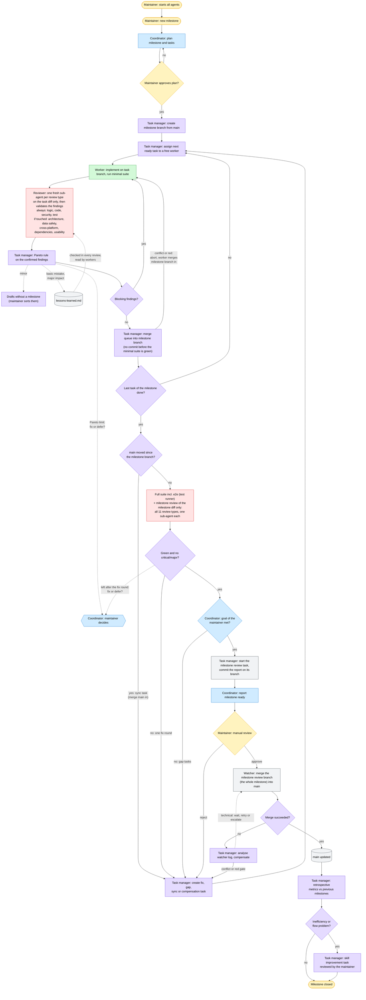

# Multi-agent milestone workflow (draft)

First sketch of the workflow: several AI agents (coordinator, task manager, workers, reviewer with review-type
sub-agents, test runner) work on the tasks of a milestone. The maintainer starts all agents at the beginning of the
run; only the reviewer starts sub-agents (one fresh sub-agent per review type and review).
Task branches are merged into the milestone branch after the agents' review; only the whole milestone gets a
manual review in the review app (the milestone review task, whose branch carries the milestone branch and the
report) before it is merged into `main`.

## Branches and state

```
main  <-  milestone review task branch  <-($BNG update)-  milestone-<slug>  <-  task-<id>-<slug> (one per task)
```

- `milestone-<slug>` is the only integration branch. The task manager creates it (and its own worktree, the
  *milestone checkout*) before the first task starts, merges task branches into it and commits lessons there.
- Every code change goes through a task branch into the milestone branch, also after the hand-off (fix tasks after
  a rejection, compensation after a failed merge into `main`, the sync with `main` before the gate).
- The milestone review task's branch starts from the milestone branch after the gate; it gets only the report
  commits and, via `$BNG update`, the milestone branch's later merges. The watcher merges it into `main` after the
  maintainer's approval.
- Nothing merged is ever rewritten; agents never rebase. Each file has one writer at a time (task files, findings,
  test reports, lessons): see [agent-skills.md](agent-skills.md#state-and-who-writes-it).

New here? Start with [README.md](README.md) (reading order, glossary).
Agents, their skills and how the skills become active: [agent-skills.md](agent-skills.md).
Open points still to brainstorm: [open-points.md](open-points.md).
Goals, decision rights, phases with entry and exit criteria, exception paths: [requirements.md](requirements.md).
Basic mistakes with a major impact are recorded as lessons learned and checked in every review (see
[Lessons learned](#lessons-learned)).

Colours: yellow = maintainer, blue = coordinator, purple = task manager, green = worker, red = reviews and tests,
grey = git. The diagram's source is `tutorial-src/diagrams/workflow.mmd`; keep this copy identical.



## Merge into main fails after the manual review

After the maintainer's approval, the backlog-ng watcher merges the milestone review task's branch (the whole
milestone) into `main`. If that fails, the
watcher logs `auto-merge aborted (<branch>): <reason>`, leaves the branch and `main` unchanged, and tries again
when the branch, `main` or the verify stamps change. A background monitor in the task manager's session passes this line
to the task manager (`OPEN(#38)` in open-points.md: agents act only on messages); the task manager finds the
cause and compensates for it:

| Cause (watcher log) | Compensation by the task manager | New manual review |
|---|---|---|
| Conflicts with `main` (`main` moved: hotfix, another milestone) | Compensation task in the milestone: a worker merges `main` into its task branch and resolves the conflicts; minimal suite, review of the conflict resolution diff only (reviewer), merge into the milestone branch, full suite (test runner) | Only the new commits |
| Quality gate red on the merged result (the code fits `main` textually, but not semantically) | Regression task as in the milestone gate: test runner finds the failing tests, fix on a task branch merged into the milestone branch, full suite | Only the fix commits |
| Technical: git busy (`index.lock`), main checkout with uncommitted changes, verify bridge or watcher down | No code change; wait for the watcher's automatic retry (up to 15 min); if it doesn't recover, escalate to the coordinator (the main checkout is the maintainer's, the task manager never cleans it) | No |
| Unknown cause, or the same merge failed twice after compensation | Escalate to the coordinator with the watcher log lines and what was tried | Maintainer decides |

Rules:

- The task manager never merges into `main`, never pushes or force-pushes, and never rewrites already approved
  commits: compensation is always new commits that reach the milestone branch through a task branch (merge `main`
  in, no rebase); then `$BNG update` merges them into the milestone review branch.
- Approvals of the earlier commits stay valid; the maintainer reviews only the compensation commits.
- After the compensation, the normal path applies again: milestone gate, report addendum, coordinator reports
  "ready again" with the reason for the failed merge and what was changed.
- To verify: whether the review app keeps the earlier approvals when new commits are added to an approved branch.

## Goal check (coordinator)

- When the milestone is planned, the coordinator stores the maintainer's goal **verbatim** in the milestone
  description, plus the success criteria agreed in the planning talk. The goal is never reworded later.
- Before the report is written, the coordinator checks the result against that goal, independent of the task list:
  per goal statement and success criterion, the evidence (task, test, demo, screenshot) or "not met".
- Not met because something is missing → gap tasks via the task manager (normal path again). Not met because the
  goal itself is unclear or changed → ask the maintainer, no guessing.
- The goal check is part of the hand-off: the maintainer sees goal, evidence and gaps in one place.

## Loop guard (coordinator)

Agents may talk to each other only for coordination; every exchange has to move the work forward.

- **Typed messages only** (see agent-skills.md); every message is about one task and must lead to a state change
  (task status or notes, a commit, a new task, a findings file, a test report: files a hook can check). Small talk,
  acknowledgements and "thanks" are not sent.
- **Limits per task and pair of agents**: at most 3 messages in a row without a state change (the 4th is blocked),
  at most 2 rounds on the same question. Then the question goes to the coordinator, who decides or asks the
  maintainer.
- **Enforced by a hook**, not only by the skill: a hook on `SendMessage` counts the messages per task and pair since
  the last state change and blocks the next one with "escalate to the coordinator".
- **Deadlock check**: the coordinator looks at who waits for whom (blocked tasks, open questions); a cycle or an
  agent idle with assigned work is resolved by the coordinator (reassign, decide or ask the maintainer).
- **Budget per task** (turns or tokens) and per milestone; when a task reaches it, the task manager stops it and
  escalates instead of continuing.
- `pause` is the one message that gets an answer without other work: the task manager sends `paused` once no task
  runs any more (a state change).
- The coordinator reports loop-guard events in the status and in the retrospective (they are a sign of unclear
  tasks or skills).

## Retrospective and continuous improvement (task manager)

After the milestone is merged into `main`, the task manager runs a retrospective. The goal: each milestone runs a
bit more smoothly than the previous one, without the workflow growing more complex.

**Metrics** (collected from task files, git history, watcher log, test reports and loop-guard events; stored per
milestone in `docs/retros/m<n>.md` so they can be compared over time):

- review rounds per task, findings per review type, findings dropped by the reviewer (false positives),
  confirmed findings overturned on a worker's dispute
- findings the maintainer found in the manual review that the agents missed (the most important signal)
- lessons learned: new ones, and repeats of existing ones
- merge-queue conflicts and red minimal suites after a merge
- full-suite failures and regressions, flaky tests
- failed merges into `main` and their causes
- escalations and loop-guard events
- time or tokens per task, idle workers, tasks taken back from stalled workers

**From metrics to improvements:**

1. Compare with the previous milestones; an inefficiency is a metric that is clearly worse than before or a
   problem that occurred repeatedly (e.g. the same kind of finding in several tasks, a review type that only
   produces dropped findings, many conflicts between parallel tasks).
2. Pareto here too: only the 1-3 issues with the biggest effect, each with its evidence.
3. For each, a concrete change: a skill, a checklist, the review-type selection, the minimal suite, the task sizing,
   a limit. The flow itself (this document and the diagram) is changed only if the problem cannot be fixed in a skill.
4. The changes are an **improvement task** with a normal branch and review: the maintainer approves every skill
   change in the review app. Agents never change their own skills without that review.
5. The next retrospective checks whether the change helped; a change that did not help is reverted.

**Limits:** hard rules (never merge into `main`, `--ignore-scripts`, domain whitelist, reviewers without git, agents
never defer critical/major findings, the maintainer's manual review) are not subject to improvements by agents. A skill change must not contradict another
skill or this document; the improvement task gets a consistency review for that. Skills should get shorter or
stay the same size more often than they grow.

## Lessons learned

A basic mistake that caused, or would have caused, a major problem is recorded once in the project's lessons-learned
file (default `docs/lessons-learned.md`), so it doesn't happen again. Details: the task manager's
`references/lessons-learned.md`.

- **When**: all three are true: a simple, general cause that a one-line rule could have prevented (unchecked input,
  path built by string concatenation, missing error path, forgotten platform, test that checks nothing, ...); a
  critical or major impact; confirmed (by the reviewer, a failed test, or found by the maintainer).
- **Sources**: confirmed critical/major review findings, full-suite failures and regressions, findings of the
  maintainer's manual review (always checked: the agents missed them), failed merges into `main`, workflow incidents.
- **Who and when**: the task manager, right away (not at the retrospective), as a commit `lessons: L-<n> <title>` on
  the milestone branch; the maintainer sees every new lesson in the manual review.
- **Entry**: what the mistake was, one checkable rule, how to spot it in a diff, the review types it applies to,
  where it was seen, status (active, automated, retired).
- **Use**: workers read the active lessons before they implement; every review-type sub-agent checks the diff against
  the active lessons of its type (still the diff only); the milestone review checks all of them. A violation is reported with
  `lesson: L-<n>` and is never minor.
- **Repeat**: a lesson seen a second time is not enforced well enough by text; the retrospective turns it into a
  test, lint rule or hook, or sharpens its rule. General lessons are proposed for the reviewer checklists, so other
  projects benefit too. The file stays short (at most 30 active lessons).

## Review scope: only new and changed parts

Every review looks only at what the task or milestone added or changed, never at the whole code base.

| Review | Scope (diff) |
|---|---|
| Task review | `git diff $(git merge-base <milestone-branch> <task-branch>)..<task-branch>` |
| Re-review after fixes | only the fix commits since the previous review round |
| Re-review after the worker merged the milestone branch into the task branch | the whole task diff again (logic, code, test) |
| Milestone review | `git diff $(git merge-base main <milestone-branch>)..<milestone-branch>` |

- Reviewers may read unchanged code for context (callers, interfaces), but a finding must be about a changed line.
- A problem in unchanged code counts only if the change makes it reachable or worse (e.g. a new caller of an unsafe
  old method); the finding then points to the changed line. Anything else in old code is not reported at all.
- Reviewers get the diff as a file and a checkout of the reviewed state (`tree`) for context, and run no git
  commands themselves: least privilege, and git commands in the maintainer's main checkout can take
  `.git/index.lock` and make a merge by the watcher fail.
- Task branches are never rebased: on a failed merge into the milestone branch, the task manager aborts the
  uncommitted merge and the worker merges the milestone branch into the task branch, so reviewed commits stay as
  they are.

### Reviewer and validation

- The reviewer is a long-running agent. For each review it starts one fresh sub-agent per review type (agent
  `milestone-review-type`), which has never seen the code, gets only its type's checklist, the diff, the tree and
  the lessons, and reports only findings.
- The reviewer then validates every finding: format and scope, duplicates across types, and for critical and
  major findings a re-read of the code in context; where an existing test or a short command can show the
  defect, the test runner reproduces it. Unconfirmed findings are dropped with a reason and counted per type.
- The task manager gets only confirmed findings (findings file) and applies the Pareto rule; it does not
  double-check again. A worker can dispute a confirmed finding (`blocked`); the task manager decides.

### Reviews are to the point

- Only findings: no summary of the change, no praise, no "looks good", no general advice, no style preferences.
- Only findings of the reviewer's own review type, and only with a concrete failure scenario. "Could be a problem"
  without a scenario is not a finding.
- One finding per real defect; the same defect at several places is one finding with all places.
- No findings: the result is just `0 findings`.
- A finding that breaks a lesson learned gets the extra line `lesson: L-<n>`.
- Fixed format per finding (the task manager turns it into a task without rewording); the source is the
  `milestone-review-type` skill, the reviewer's findings file adds `type:` and `checked:`:

```
finding 1
severity: critical | major | minor
where:    path/to/file.ext:123 (changed line)
what:     one sentence: the defect
scenario: concrete input or state -> wrong result, crash, data loss, ...
fix:      one sentence: suggested fix
lesson:   L-<n> (only if the finding breaks a lesson)
```

### Deferring findings

- Minor findings never block; they become drafts without a milestone and are listed at the hand-off, where the
  maintainer sorts them (next milestone, backlog, discard). Agents never discard a draft.
- A critical or major finding is never deferred by an agent. When the Pareto limit is reached, or one is left
  after the milestone gate's single fix round, the task manager escalates "fix or defer"; the coordinator asks the
  maintainer. Deferred critical/major findings are listed separately at the hand-off. Failing tests left after the
  gate's fix round are escalated the same way.
- Lesson violations block in every round.

## Review types

The checklists of the review types are in `skills/milestone-reviewer/types/`. Each one is done by a fresh
sub-agent that did not write the code, on the diff only (see above); the sub-agents only report back to the
reviewer. A task review only gets the types that fit its diff, while the milestone review always runs all of them.
The selection rules (column "Per task") and the Pareto rule are kept in one place: the task manager's
`references/reviews.md`; the table below is the overview.

| # | Review type | Checks | Per task | Milestone |
|---|---|---|---|---|
| 1 | Logic | acceptance criteria and PRD requirements really met, tasks consistent with each other | always | yes |
| 2 | Code | bugs, resource leaks, concurrency, error paths, unusual input | always | yes |
| 3 | Architecture | layers, module and package boundaries, decisions that should be recorded | if structure, modules, packages or interfaces change | yes |
| 4 | Security | endpoints, input validation, path traversal, injection, secrets, logs | always | yes |
| 5 | Data safety | everything that reads, writes, moves or deletes user data | if code that touches user data changes | yes |
| 6 | Cross-platform | paths, scripts, OS-specific behaviour on every supported platform | if platform code, paths or scripts change | yes |
| 7 | Dependencies and licenses | new or upgraded dependencies, licenses, pinning, `--ignore-scripts` | if build or lock files change | yes |
| 8 | Docs | README, CLAUDE.md, PRD, task notes, Mermaid diagrams up to date | – | yes |
| 9 | Usability | UI, messages, defaults, empty/error states, accessibility | if UI, messages or CLI output change | yes |
| 10 | Code quality | readability, duplication, dead code, unnecessary complexity | – | yes |
| 11 | Test | tests check behaviour, missing tests, coverage, flaky or slow tests | always | yes |
