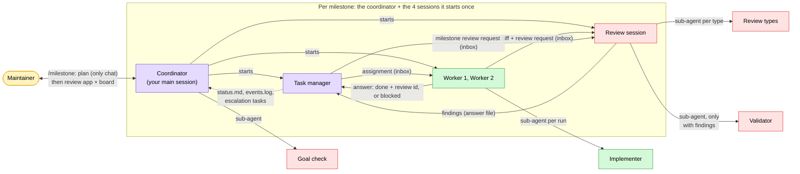

# Milestone workflow v1: install and try

v1 runs a milestone with **five sessions**. **Sessions supervise, sub-agents work.**

- The **coordinator** is your main session (`/milestone`): it plans with you, starts the other four sessions once,
  runs the goal check (as a sub-agent) and hands the milestone over.
- The **task manager** owns everything in backlog-ng during the run: it assigns tasks to the workers, collects the
  review results and plans the follow-ups (fix, merge or In Review, lessons). It runs no sub-agents itself.
- Two **workers** (`worker-1`, `worker-2`) each take one task at a time from their inbox, have a fresh implementer
  sub-agent do it, check the result and hand it straight to the review session.
- The **review session** reviews each hand-over with one fresh sub-agent per review type, plus a validator only when
  there are findings, and sends the result to the task manager.

Sessions exchange only files: inboxes for assignments and requests, answer files for results.



The same picture is in the draft (§2); one task's flow and the branches are drawn in its §4 and §5
([../blueprint-v1-draft.md](../blueprint-v1-draft.md)). Change the diagrams in both places together.

Every task gets an agent review of the whole task until nothing blocks. Then it depends on the **review mode** you
choose at planning:

| | `milestone` (default) | `per task` (only if you ask for it) |
|---|---|---|
| you review | only the milestone review task at the end | every task in the review app, then the milestone |
| task merge into the milestone branch | the task manager, right after the agent review (interim, until backlog-ng can finish a review as agent) | the watcher, after your approval and its quality gate (`tools/verify.sh`) |
| in the milestone review | task commits show as open: that's where you review them, grouped by task | task commits show as approved |
| size | ≤ ~2,000 changed lines per milestone | no cap beyond the task limits |

Sub-tasks are steps of one task with no own branch and no manual review of their own: after the last sub-task the
whole task gets one full agent review (bigger tasks also one per sub-task). Work bigger than one reviewable branch is
planned as several tasks with dependencies. After the gate and the goal check, you review the whole milestone; the
watcher merges it into `main` after your approval.

**Lean by design** (after the first trial run's overhead): the plan has the fewest tasks that keep each ≤ ~400 changed
lines (a task under ~150 lines is merged into a neighbour unless it is risky on its own); task texts and notes stay
short; a small diff (≤ ~150 lines) gets one review sub-agent, the validator runs only when there are findings, and the
milestone review is one sub-agent. Minor findings go into one "Deferred minor findings" list in the milestone report,
not into draft tasks. A task's status changes only at start and merge.

**Product docs are part of every task** (D11): the implementer updates the README usage or reference for each
user-visible change in the same commits (decision records and `CHANGELOG.md` only if your project already keeps
them), and the task notes always say `docs: <files>` or `docs: none needed (<why>)`. The task manager checks that
line; the reviews treat a user-visible change without its doc as major, and the milestone review runs the docs
checklist. Process files (retro, lessons, task notes) don't count as product docs.

**v1 needs the Claude desktop app** (Code tab): the coordinator starts the other four sessions through the app.
There is no CLI fallback.
The design and its reasons are in [../blueprint-v1-draft.md](../blueprint-v1-draft.md); the binding names, formats
and paths are in [INTERFACES.md](INTERFACES.md).

## What is in here

| In `v1/` | What it is | Installed to |
|---|---|---|
| `commands/milestone.md` | `/milestone start\|resume\|status`, run in the main session; loads the coordinator | `commands/` |
| `skills/milestone-coordinator/` | coordinator (your main session): plan, escalations, goal check, hand-off, retro | `skills/` |
| `skills/milestone-task-manager/` | task-manager session: tasks, statuses, assignments, collecting review results, Pareto, merges or In Review, watcher, gate; with `references/reviews.md` and `references/merge-recovery.md` | `skills/` |
| `skills/milestone-worker/` | worker session: takes task assignments, has an implementer do each, checks it, hands it to the review session | `skills/` |
| `skills/milestone-implementer/`, `agents/milestone-implementer.md` | sub-agent of a worker: implements, fixes or merges in one task in its worktree | `skills/`, `agents/` |
| `skills/milestone-review/` | review session: selects the review types, runs the sub-agents below, writes the validated findings | `skills/` |
| `skills/milestone-review-type/`, `agents/milestone-review-type.md` | sub-agent of the review session: one diff, one review type; checklists in `references/types/` | `skills/`, `agents/` |
| `skills/milestone-validator/`, `agents/milestone-validator.md` | sub-agent of the review session: confirms or drops the findings of one review | `skills/`, `agents/` |
| `skills/milestone-goal-check/`, `agents/milestone-goal-check.md` | sub-agent of the coordinator: checks the result against your goal, criterion by criterion | `skills/`, `agents/` |
| `scripts/milestone-test.sh`, `scripts/milestone-check.sh`, `scripts/milestone-wait.sh` | test suites, flaky check, bisect, reproductions; prerequisite check; the sessions' wait loop | `~/.claude/milestone/scripts/` |
| `hooks/guard-*.sh`, `hooks/settings-snippet.json` | the hard-rule hooks and the settings that enable them | `~/.claude/milestone/hooks/` |

## Install

Run the steps from the blueprint folder. Skills, agents and the command go to `~/.claude/` (all projects;
simplest) or a project's `.claude/` (only that project; then **commit it to `main`** before `/milestone start`,
because the sessions run in worktrees and see the project's `.claude/` only as committed). **Scripts and hooks always
go to `~/.claude/milestone/`**: a copy inside the project could be changed by an agent to fake a green test or switch
a guard off (a lesson from the first trial run), so the check script reports a project copy as missing.

1. **Skills, agents, command**:

   ```bash
   T=~/.claude   # or T=<project>/.claude, then commit it
   mkdir -p "$T/skills" "$T/agents" "$T/commands"
   cp -R v1/skills/milestone-* "$T/skills/"
   cp v1/agents/milestone-*.md "$T/agents/"
   cp v1/commands/milestone.md "$T/commands/"
   ```

   **v1 replaces older installs.** The agents are only `milestone-implementer`, `milestone-review-type`,
   `milestone-validator` and `milestone-goal-check`. Remove any other `milestone-*` agent file from `$T/agents/` (and
   from `~/.claude/agents/` if you install per project): `milestone-worker`, `milestone-coordinator`,
   `milestone-task-manager`, `milestone-reviewer`, `milestone-test-runner` from earlier versions. Also remove the
   skill `milestone-orchestrator`,
   `milestone-reviewer` and `milestone-test-runner` if present. A project-level copy
   wins over `~/.claude/` for that project.

2. **Scripts and hooks**, always into `~/.claude/milestone/` (not `$T`):

   ```bash
   mkdir -p ~/.claude/milestone
   cp -R v1/scripts v1/hooks ~/.claude/milestone/
   chmod +x ~/.claude/milestone/scripts/*.sh ~/.claude/milestone/hooks/*.sh
   ```

   Then merge `hooks/settings-snippet.json` into `~/.claude/settings.json`. Every hook runs only from
   `~/.claude/milestone/hooks/` and blocks (exit 2) if its script is missing. The hooks apply to every session and its
   sub-agents. The web hook reads `~/.claude/allowed-domains.txt`. If an earlier install put a `.claude/milestone/`
   folder into the project, delete it (and keep `.claude/milestone/` in `.gitignore`).

3. **Project `CLAUDE.md`**: add this section (one `- Key: value` line each; the check script reads it):

   ```markdown
   ## Milestone workflow
   - BNG: tools/backlog-ng/backlog-ng.sh
   - Minimal test command: ./gradlew test -PexcludeTags=slow
   - Full test command: ./gradlew test e2eTest
   - Single test command: ./gradlew test --tests {test}
   - Test reports: build/test-results/**/*.xml
   - Docs to check against: docs/prd.md, docs/adr/
   - Lessons file: docs/lessons-learned.md
   - Watcher log: ../<project>-backlog-ng/watcher.log
   - Supported platforms: linux, macos, windows
   ```

   The values are examples. `Single test command` must contain `{test}`. `Test reports` is a JUnit XML glob.
   `Lessons file` defaults to `docs/lessons-learned.md`; the task manager creates it with the first lesson.

Prerequisites: a git repository with `main`, backlog-ng with milestone branches (`BNG_MILESTONE_BRANCHES=yes`) and
its watcher running, an executable `tools/verify.sh` (the watcher's quality gate before each merge) **committed on
`main`** (a first milestone can't bring it along: the milestone branch starts from `main`), a minimal and
a full test suite with JUnit XML reports, and `bash`, `git` ≥ 2.29 and `jq` (the
hooks need it).

## Setup (once per project, on `main`, before the first `/milestone start`)

Do this by hand and commit it on `main`, never as tasks of a milestone: the milestone branch starts from `main`, and
`milestone-check.sh start` runs on `main` before any milestone exists (the first trial run did hooks and the label as milestone
tasks, and its own check couldn't see them).

1. The `## Milestone workflow` section in `CLAUDE.md` (above).
2. An executable `tools/verify.sh` (the watcher's quality gate).
3. The labels `milestone-review` and `escalation` in `backlog/config.yml`.
4. `.claude/milestone/` in `.gitignore` (no project copy of scripts or hooks).
5. The hook snippet in `~/.claude/settings.json`, or in the project's `.claude/settings.json` committed on `main`.

## Running a milestone

In the Claude desktop app, open a Code session in the project's main checkout.

1. **`/milestone start`** checks the prerequisites (`milestone-check.sh start` lists what's missing and stops), then
   plans the milestone with you: goal, success criteria, out-of-scope list, tasks. It asks once: "Do you want to
   review every task yourself in this milestone? Default: no". Answer yes only if you want that control; otherwise
   the review mode is `milestone`. This is the only chat. Approve the plan, and the coordinator creates the tasks and
   starts the task manager.
2. **Then leave the chat.** The coordinator stays in that `/milestone` turn and waits for the task manager; it never asks
   you anything there. **Nobody just watches:** after every wake-up, the coordinator and the task manager each run an
   idle check and take the next step themselves (dispatch, review, merge, goal check, hand-off, retro). If only you
   can move, it is signalled (👀 or ⚠️, never silent); if nothing can move, you get ⚠️ "stuck" with the state, and an
   escalation task. If the coordinator's turn has to end while the milestone is open, it tells you with ⚠️ to type
   `/milestone resume`. Everything you do from now on happens in backlog-ng:
   - **Review app**: in `milestone` mode only the milestone review task (with the report) comes In Review at the end;
     review the task commits there, grouped by task. Don't approve single tasks in the app in this mode: that would
     add a second merge path. In `per task` mode every task that is In Review has passed its agent review; approve it
     or reject it with a note, and at the end the milestone review task comes In Review the same way.
   - **Board**: questions only you can answer (fix or defer, an unclear requirement, a limit reached) appear as
     tasks labelled `escalation` in the milestone. Answer in the task's notes and set it Done. Only the work that
     depends on it waits.
   - **Signals**: you don't need to watch the sessions. The coordinator's session title in the sidebar shows what
     waits for you, for example `👀 2 · ⚠️ 1 · M3 search`; each new item also gets a chat line, marks the session
     unread and sends one notification.

     | Icon | Means | You do |
     |---|---|---|
     | `👀 <n>` | n reviews wait: the milestone review task, and in `per task` mode also tasks, are In Review | open the review app, approve or reject each |
     | `⚠️ <m>` | m items need you: an open escalation task, a stuck session, or a failed step. The chat line names it and links a stuck session | escalation: answer in the task's notes on the board, set it Done. Stuck session: open it from the link and answer its prompt or question there. Failed: follow the chat line, often `/milestone resume` |
     | `✅` | the milestone is merged into `main` | read the retro draft |
     | no icon, `· running` | nothing waits for you | nothing |

     A session counts as stuck if it waits on a permission prompt or a question, if the task manager has had no
     activity for 20 min (it wakes at least every 9 min), if a worker's assignment or a review request has no answer
     75 min after it was written, or if it ended its turn while the milestone is still running. The coordinator never answers a prompt for you; it replaces an ended session once.
3. **`/milestone resume`** only if something got stuck: the coordinator's turn ended (crash, app restart), or a
   session ended. It replaces ended sessions, starts pending ones and waits again.
4. **`/milestone status`** shows `status.md` at any time: phase, tasks per status, what each worker and the review session is doing, open escalations.

**The sessions you'll see** in the app's sidebar, per milestone, a short and fixed list:

| Session | Role |
|---|---|
| your `/milestone` session | coordinator; its title carries the signals |
| `task-manager-m<n>-1` | task manager |
| `worker-1-m<n>-1`, `worker-2-m<n>-1` | workers |
| `review-m<n>-1` | review session |

That's 5 per milestone, and the list doesn't grow. Only the coordinator starts, stops and archives sessions; no v1
session starts follow-up sessions. A `-2` (and so on) appears only when a session had to be replaced; the coordinator
archives the old one first. Sub-agents don't appear in the sidebar. You can open the sessions to watch; they never
wait for you.

**Archived, never deleted.** Replaced sessions, and all sessions at the end of the milestone (merged or cancelled),
are archived by the coordinator, so their transcripts stay available for the retro. Find them in the app's archived
sessions in the sidebar; to look at one again, open it there or unarchive it. Don't restore a replaced session into a
running milestone: its replacement already owns that role.

## Known gaps

v1 is untested. These are the open questions and the known limits, in the order the spike and the dry run should
look at them.

- **The waiting model is unverified.** Session starts are allowed only in a turn begun by you (or, for the task
  manager, by the coordinator's start), so the coordinator and the task manager never end that turn: they wait in
  it with `milestone-wait.sh` (at most 9 min per call, repeated). The spike must check that `start_session` still
  works hours into such a turn, and that the harness allows a script that sleeps in the foreground. This Claude
  Code build blocks a plain foreground `sleep` and limits one Bash call to 10 min.
- **Waiting has a cost and a setting.** Each waiting session makes about one model call per 9 min while idle.
  `milestone-wait.sh` must be called with the Bash tool timeout at 600000 ms; with the default limit the tool ends it
  early. Its `status` source parses `$BNG cli task list --plain` (status headers ending in `:`, task lines with
  `task-<n>`) every 30 s and tracks all board tasks; a different board output format breaks it.
- **Stuck detection is partly unverified.** `list_sessions` doesn't document a "waiting for permission" state, so the
  coordinator reads the task manager's last transcript lines with `list_events`. `list_events` may ask for approval
  in managed deployments that restrict workspace folders.
- **Don't rename the coordinator session yourself.** After a manual rename, `set_session_title` asks you before it
  changes the title again, and in an unattended session that is declined: the counts would stop updating.
- **No push notification while you are at the app**; then only the title, the unread mark and the chat line signal.
- **Archiving asks for approval.** `archive_session` asks you to approve each call in the default permission mode.
  Run the coordinator in auto mode, or accept one approval card per archive, which counts toward G0's maintainer
  time. A pending approval doesn't block the run: the predecessor is already stopped. Archiving a session also
  archives its finished side sessions that share its folder.
- **One turn holds a whole milestone.** Context grows inside that turn and may be compacted; both roles must work
  from the files (`status.md`, `events.log`, task files, findings), not from memory. Check after a compaction in the
  dry run.
- **Open escalations block the hand-off.** The review app waits while any non-draft task of the milestone is open,
  so an unanswered escalation task holds back the milestone review. That is intended; answered (Done) escalations
  don't block.
- **A crashed coordinator turn needs you.** If its turn ends (crash, app restart), the run waits until you type
  `/milestone resume`. That is the one chat action left during a run.
- **Hooks and scripts only from `~/.claude`.** Since the first trial run no project-level copy of scripts or hooks is
  used. A hook entry only in an uncommitted project `settings.json` or in `settings.local.json` doesn't reach the
  sessions in worktrees; keep the snippet in `~/.claude/settings.json`.
- **A missing hook script blocks everything.** Each hook command fails closed: until the script is installed, every
  Bash and web call in the project is blocked. This is deliberately loud.
- **The check can't see the app.** `milestone-check.sh` can't verify that the desktop app's session tools exist; the
  coordinator stops itself if it has no `start_session`.
- **Unverified harness behaviour.** To check in the next trial run: hooks fire in the sessions' sub-agents; a worker's implementer
  finishes within the 60-min assignment limit; an overdue assignment or request (75 min) is enough to tell a hung session from a waiting one, since sessions report
  no liveness of their own; check and
  resume work with five waiting sessions.
- **Five sessions wait.** Each waiting session costs about one model call per 9 min while idle. The worker hands a
  task straight to the review session; every decision about it (fix, merge, In Review) stays with the task manager.
- **Depends on a backlog-ng change.** The review app must offer a task's tree only while the task is In Review.
  Without that change, you could approve a task whose agent review is still running (the race seen in the first
  trial run). Don't run v1 before backlog-ng has it.
- **Depends on a backlog-ng change** (retry after a transient merge failure, e.g. an `index.lock` in the task's
  worktree). Until it is merged, the watcher may skip the merge of an approved task and never retry; the task
  manager then triggers `$BNG finish` once for that task and, if it still isn't merged, escalates. No agent runs git
  in a task's worktree while the task is In Review, so agents don't cause that lock themselves.
- **Interim merge by the task manager** (`milestone` mode). Until backlog-ng can finish a task review as agent (open
  point #3, (a)), the task manager merges agent-reviewed tasks itself. `guard-main.sh` allows exactly that merge on
  `milestone-*`: path-based (only in `<repo>.worktrees/milestone-<slug>`), and it checks that a validated findings
  file exists, not that nothing blocks. In this mode the milestone review shows the task commits as open, which is
  intended.
- **In `milestone` mode, review only the milestone review task.** Until backlog-ng hides the trees of tasks that
  aren't In Review (a backlog-ng change), approving a task in the app would make the watcher merge it as well.
- **More maintainer reviews in `per task` mode.** You review every task, plus every fix, sync and regression task,
  and then the milestone. That counts toward G0's maintainer time; the G0 dry run uses the default `milestone` mode.
- **Rejections and escalation answers are noticed by polling** the task statuses (`milestone-wait.sh`); the app
  doesn't log them.
- **Lessons travel with their task.** A lesson is committed on the task branch where it was found, so other tasks'
  implementers and reviews see it only after that task is merged. Two tasks that add a lesson at the same time can
  conflict in the lessons file; the merge then aborts and a merge-in implementer resolves it.
- **New task files stay uncommitted** (old #2, seen in the first trial run). Escalation, fix, gap and regression tasks are
  created with `$BNG cli` in the main checkout, and nothing commits them there (the watcher never commits board
  changes on `main` or `milestone-*`). They work on the board but aren't in git. Design question for you: who
  commits them, and where.
- **A task manager that is gone** is restarted by `/milestone resume`; it rebuilds its state from the files.
- **Nobody independent watches the task manager** except the coordinator, which sees only its reports, and you.
- **Numbers are guesses**: the 60-min assignment limit, 400 changed lines per task or sub-task, ~1,000 per task with sub-tasks, "wait up to 15 min" for the watcher,
  the 10-line hand-off. Calibrate them in the dry run.
- **Sessions are limited by instruction, not by tools.** The task manager, the workers and the review session have
  no agent file; their skills and the hooks keep them to supervising. The review-type, validator and goal-check sub-agents are
  read-only by tools.
- **The goal check can't run commands.** A `verified by: command` criterion is met only if a task note records the
  command and its output; otherwise it goes to the manual review.
- **Implementers don't know their time limit.** They commit early, so a timeout loses little.
- **Hooks are a safety net, not a sandbox.** They split commands simply (no quote handling), so `bash -c '...'`,
  scripts, aliases, `git update-ref` and `git branch -f` get through. `guard-web` checks only URLs with a scheme in
  `curl`/`wget`; other network tools aren't checked. `guard-install` and `guard-web` defer to your global hooks if
  `~/.claude/settings.json` already has one for the same tool; `MILESTONE_GUARDS_FORCE=1` turns that off.
- **Test script limits.** `{test}` is the JUnit `<classname>.<name>`; other test ids need a wrapper as the
  `Single test command`. A failure outside JUnit (e.g. a compile error) is reported as red with
  `test: (unparsed, see log)`. A broken environment that exits with a normal code looks red, not error. A repro
  timeout is reported as error, though it may be the hang the finding describes. Bisect needs git ≥ 2.29 and
  recognises a cause only if the merge subject contains `TASK-<id>`. Reports are named `<suite>-<short-sha>`, so a
  rerun on the same commit overwrites the earlier one.
- **The check script is minimal.** "Watcher runs" is checked only through the `Watcher log` key (no file → missing;
  not written for 24 h → warn). Installed skill versions are not compared with the blueprint.
- **Checklist `10-code-quality.md` is not used** by any v1 review type. It is kept for a later split of the review
  types.
- **Open decisions for the maintainer**: #7, #10, #24, #25, #26, #36 and the G0 threshold
  (`../blueprint-v1-draft.md`, section 10).
